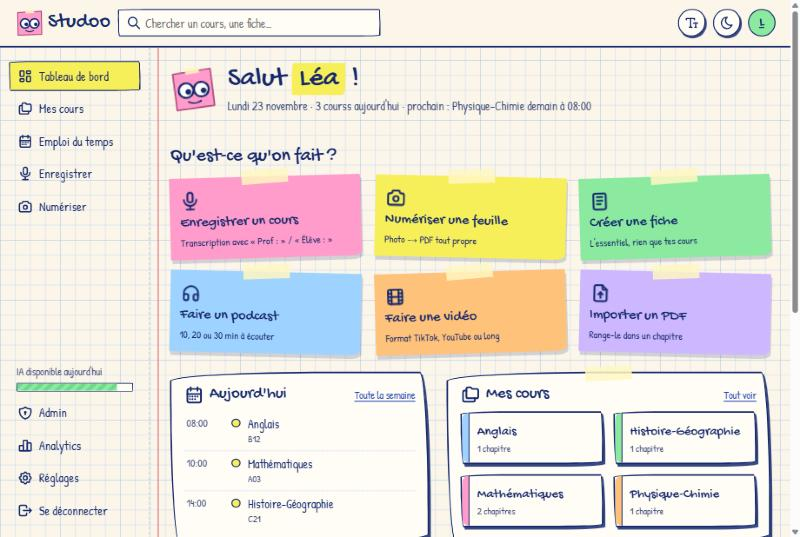
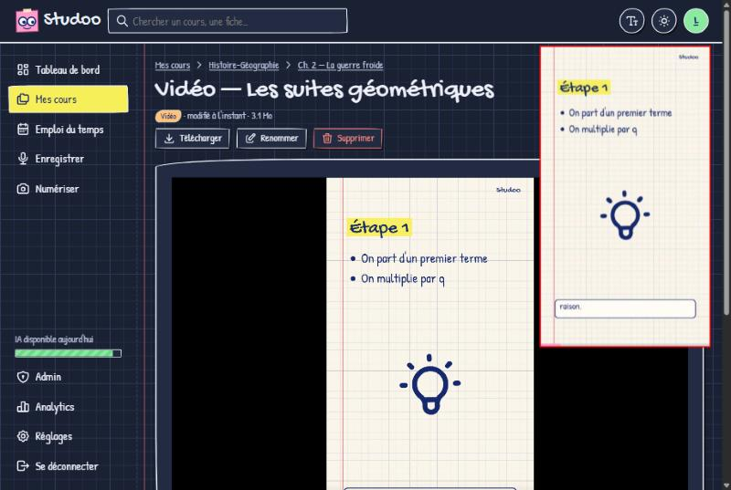
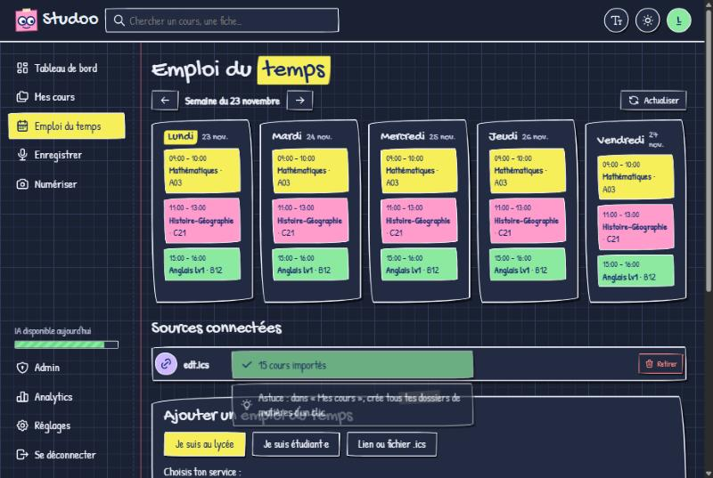

<p align="center">
  
</p>

<h1 align="center">Studoo</h1>

<p align="center"><strong>Tes cours, au propre.</strong><br>
Un site de révision pour lycéens et étudiants : transcription de cours, numérisation de feuilles,<br>
fiches, podcasts et vidéos générés <em>uniquement</em> à partir de tes propres cours, le tout rangé dans ton Google Drive.</p>

<p align="center">
  <a href="https://studoo-app.vercel.app">studoo-app.vercel.app</a> ·
  <a href="docs/ARCHITECTURE.md">Architecture</a> ·
  <a href="docs/DEPLOIEMENT.md">Mise en ligne</a>
</p>


## Ce que fait Studoo

| Outil | Comment |
|---|---|
| 🎙️ **Enregistrer un cours** | Le micro de l'appareil enregistre par tranches de 5 min. Chaque tranche est transcrite par **Azure AI Speech** avec le **rôle de chaque personne** (« Professeur : », « Élève : »), puis **l'audio est effacé**. |
| 📷 **Numériser une feuille** | Photo → détection de la feuille → redressement → suppression des ombres → **PDF propre**. Traitement d'image écrit à la main en JavaScript, dans le navigateur. |
| 🗂️ **Ranger automatiquement** | Après chaque enregistrement/numérisation, Studoo **devine le cours** (emploi du temps + IA), le chapitre et **génère le titre**. |
| 📝 **Fiches de révision** | Fiches dessinées à la main (définitions surlignées, formules encadrées, pièges, mini-quiz), exportables en PDF. |
| 🎧 **Podcasts** | 10, 20 ou 30 min, dialogue Vivienne + Henri (voix Azure, allure radio), script écrit par GPT-4.1 mini sur le serveur de tâches. |
| 🎬 **Vidéos explicatives** | Diaporama animé dessiné + voix (Vivienne) + sous-titres, animé dans le navigateur et exportable en **MP4** (WebCodecs) : format TikTok, YouTube ou long. |
| ✏️ **Feuilles d'exercices** | Entraînement (TD), mise en pratique (TP), contrôle blanc (DST) ou questions flash (QCM), tirés des cours ; corrigé masqué ; **correction de la copie en photo** (note /20, erreurs, notions à revoir). |
| 📅 **Emploi du temps** | **Robot** : l'élève choisit son lycée et se connecte ; Studoo trouve Pronote et l'ENT régional tout seul, récupère l'emploi du temps et oublie le mot de passe. Universités et autres services : dernier recours `.ics` ([détails](docs/EMPLOI_DU_TEMPS.md)). |

<table>
  <tr>
    <td></td>
    <td></td>
  </tr>
  <tr>
    <td></td>
    <td></td>
  </tr>
</table>

<p align="center"></p>

## Choix techniques (et pourquoi)

| Partie | Technologie | Pourquoi |
|---|---|---|
| Site | **HTML, CSS, JavaScript** sans framework, assemblés par **Vite** | Comprendre chaque ligne ; site léger (Lighthouse **100/100** partout). |
| API | **Python 3 + FastAPI** | Lisible, rapide, validation automatique des données (Pydantic). |
| Connexion | **Google uniquement** (OAuth 2.0, flux « code ») | Un seul compte, qui donne aussi accès au stockage (Drive). |
| Stockage | **Google Drive** de l'utilisateur, autorisation `drive.file` | Aucun cours sur nos serveurs ; Studoo ne voit que ses propres fichiers. |
| IA | **Microsoft Azure** : AI Speech (transcription avec rôles, voix Vivienne/Henri), Azure OpenAI GPT-4.1 mini (rangement, fiches, scripts, exercices, corrections), Qwen3-VL open source sur notre serveur (lecture des photos) | Crédit Azure for Students, données en Europe (Italy North). **Aucun envoi à Google par défaut** ; chaque élève peut, s'il le veut, utiliser **sa propre clé Gemini** pour les fonctionnalités qu'il coche. |
| Base de données | **Postgres (Neon)**, SQLite en local, SQLAlchemy Core | Seulement comptes, compteurs et messages. |
| Pronote / ENT | **pronotepy** (Python, non officielle, MIT) | Robot : lycée trouvé dans l'annuaire officiel, ENT reconnu tout seul, récupération du lien iCal officiel. |
| Hébergement | **Vercel** (site statique + fonction Python) | Gratuit, déploiement automatique depuis GitHub, HTTPS. |

```
Navigateur ──► Google Drive (direct, jeton de l'utilisateur)
    │
    └──► /api (FastAPI) ──► Azure    (AI Speech, OpenAI ; clés cachées côté serveur)
    │                  └──► Neon     (comptes, compteurs)
                       └──► Pronote / ENT / ADE (emploi du temps)
```

Détails, limites et quotas : [docs/ARCHITECTURE.md](docs/ARCHITECTURE.md).

## Sécurité et vie privée

- **Aucune clé dans le navigateur** : clés Azure et secret OAuth restent dans l'API ; la clé Gemini *facultative* d'un élève est chiffrée sur le serveur et ne lui est jamais renvoyée.
- **Session chiffrée** (Fernet/AES) dans un cookie `httpOnly`, `Secure`, `SameSite=Lax` ; protection **CSRF** par en-tête dédié.
- **HTTPS forcé** + HSTS, **Content-Security-Policy** stricte, `X-Frame-Options`, `Permissions-Policy`.
- **Validation côté serveur** de toutes les entrées (tailles, formats), **limitation de débit**, formulaire de contact **anti-spam** (pot de miel + piège temporel).
- Import de liens `.ics` protégé contre le **SSRF** (adresses privées refusées, redirections vérifiées).
- **Analytics maison sans cookie** (empreinte anonyme renouvelée chaque jour), avec consentement.
- Pages **RGPD** et **CGU**, bannière cookies (« Refuser » aussi simple qu'« Accepter »), suppression du compte en un clic.

## Lancer le projet en local

Prérequis : Python 3.12+, Node.js 20+.

```bash
git clone https://github.com/B2TN/studoo.git
cd studoo

# API Python
python -m venv .venv
.venv/Scripts/activate        # Windows (macOS/Linux : source .venv/bin/activate)
pip install -r requirements-dev.txt
cp .env.example .env          # puis remplis les valeurs (voir le fichier)

# Dépendances JavaScript du site
npm install --prefix frontend
```

Dans deux terminaux :

```bash
uvicorn studoo.main:app --app-dir backend --port 8000 --reload   # API
npm run dev --prefix frontend                                     # site → http://localhost:5173
```

> **Mode démo** : sans identifiants Google, laisse `GOOGLE_CLIENT_ID` vide avec `DEV_LOGIN=1` et `AI_FAKE=1`.
> Le bouton de connexion ouvre alors une session de démonstration (faux Drive en mémoire, IA factice).
> Ces modes sont automatiquement désactivés hors `localhost`.

## Tests

```bash
cd backend && python -m pytest -q     # sessions, CSRF, quotas, IA (Azure par défaut, Gemini seulement si choisi), .ics, robots, anti-SSRF, admin…
npm test --prefix frontend             # scanner, homographie, routeur, fiches, emploi du temps…
```

Les tests tournent automatiquement sur GitHub à chaque envoi (GitHub Actions).

## Mise en ligne

Hébergement gratuit sur Vercel, base Neon, configuration Google Cloud et Search Console :
voir le guide pas à pas [docs/DEPLOIEMENT.md](docs/DEPLOIEMENT.md).

## Limites connues (offre gratuite)

- Azure AI Speech en offre gratuite (F0) : 5 h de transcription et 500 000 caractères de voix par mois pour tout le site.
- Azure OpenAI payé par le crédit Azure for Students : quotas quotidiens partagés (`QUOTA_*`) pour ne pas l'épuiser.
- Gemini n'est utilisé qu'avec la clé personnelle d'un élève qui l'a choisi ; en offre gratuite, Google peut alors réutiliser les contenus envoyés (indiqué dans les réglages et la page RGPD).
- Pronote et les ENT n'ont pas d'API officielle : les connecteurs peuvent cesser de fonctionner ; le lien iCal reste toujours possible.

## Licence et crédits

Code sous licence **GNU GPL v3 ou ultérieure** (voir [LICENSE.md](LICENSE.md)).

Icônes [Tabler](https://tabler.io/icons) (MIT) · polices Patrick Hand, Gochi Hand et Atkinson Hyperlegible (SIL OFL) ·
[pdf-lib](https://pdf-lib.js.org) (MIT) · [PDF.js](https://mozilla.github.io/pdf.js/) (Apache 2.0) · [mp4-muxer](https://github.com/Vanilagy/mp4-muxer) (MIT) ·
[lamejs](https://github.com/breezystack/lamejs) (LGPL) · [jsQR](https://github.com/cozmo/jsQR) (Apache 2.0) · [pronotepy](https://github.com/bain3/pronotepy) (MIT).
Studoo n'est affilié ni à Google, ni à Index Éducation, ni aux établissements cités.
