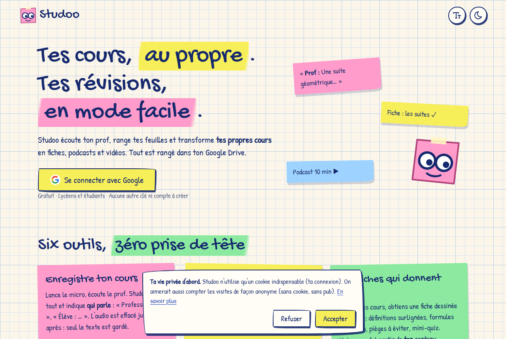
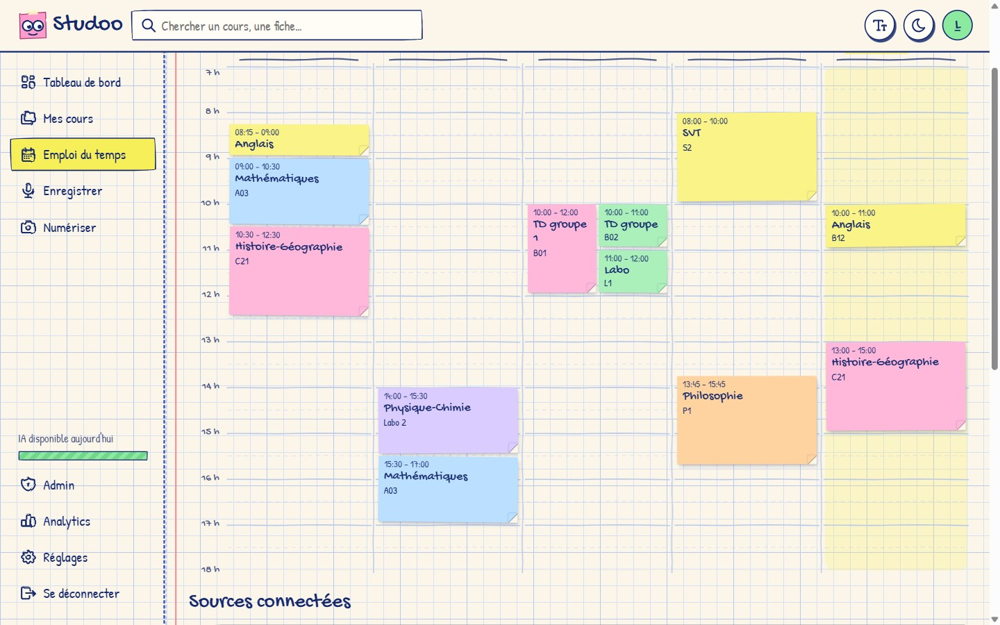
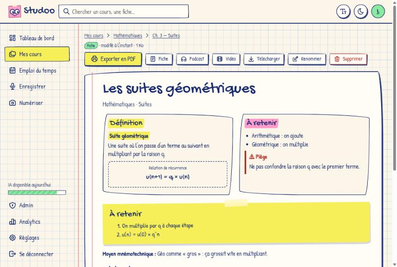

<p align="center">
  
</p>

<h1 align="center">Studoo</h1>

<p align="center"><strong>Tes cours, au propre.</strong><br>
Un site de révision gratuit pour lycéens et étudiants : transcription de cours, numérisation de feuilles,<br>
fiches, podcasts, vidéos et exercices générés <em>uniquement</em> à partir de tes propres cours, le tout rangé dans ton Google Drive.</p>

<p align="center">
  <a href="https://studoo-app.vercel.app"><strong>studoo-app.vercel.app</strong></a> ·
  <a href="docs/ARCHITECTURE.md">Architecture</a> ·
  <a href="docs/SERVICES.md">Services</a> ·
  <a href="docs/SECURITE.md">Sécurité</a> ·
  <a href="docs/LANCEMENT.md">Mise en ligne</a>
</p>



## Ce que fait Studoo

| Outil | Comment |
|---|---|
| 🎙️ **[Enregistrer un cours](https://studoo-app.vercel.app/outils/transcrire-un-cours)** | Le micro enregistre par tranches de 5 min ; **Azure AI Speech** transcrit en indiquant **qui parle** (« Professeur : », « Élève : »), puis **l'audio est effacé**. Jauge de niveau sonore, messages clairs (micro inaccessible, silence, service indisponible). |
| 📷 **Numériser une feuille** | Photo → détection de la feuille → redressement → suppression des ombres → **PDF propre**. Traitement d'image écrit à la main en JavaScript, dans le navigateur. Le texte est lu sur notre serveur par un modèle open source (Qwen3-VL). |
| 🗂️ **Ranger automatiquement** | Après chaque enregistrement ou numérisation, Studoo **devine le cours** (emploi du temps + IA), le chapitre, et **propose un titre**. |
| 📝 **[Fiches de révision](https://studoo-app.vercel.app/outils/fiche-de-revision-automatique)** | Fiches dessinées à la main (définitions surlignées, formules encadrées, pièges, mini-quiz), exportables en PDF. |
| 🎧 **[Podcasts](https://studoo-app.vercel.app/outils/podcast-de-revision)** | 10, 20 ou 30 min, dialogue Vivienne + Henri (voix Azure, allure radio), écrit sur le serveur de tâches : on peut fermer la page. |
| 🎬 **[Vidéos explicatives](https://studoo-app.vercel.app/outils/video-de-revision)** | Diaporama dessiné, commenté et sous-titré, animé dans le navigateur, exportable en **MP4** (WebCodecs) : format TikTok, YouTube ou long. |
| ✏️ **[Exercices et correction](https://studoo-app.vercel.app/outils/exercices-et-correction)** | TD, TP, contrôle blanc ou QCM tirés des cours ; corrigé caché ; **correction de la copie en photo** (note /20, erreurs, notions à revoir). |
| 📅 **[Emploi du temps](https://studoo-app.vercel.app/outils/emploi-du-temps)** | Grille **dessinée à la main**, cours en post-it **à leur heure réelle** (semaine sur PC, jour par jour sur téléphone). **Robots** : Pronote et ENT régionaux (lycées), ADE (vérifié sur un vrai compte) et Celcat (supérieur) ; **expérimentaux, jamais testés sur un vrai compte** : HyperPlanning, Aurion, ADE à identifiants propres. Le mot de passe est oublié après la connexion. À chaque échec : dernier recours `.ics` + signalement de l'établissement. |
| ⚙️ **Admin** | Comptes (supprimer ou **bannir**, journal des actions), établissements signalés, quotas, **services** (tableau de bord et mode d'emploi de chacun), schéma du site. |

<table>
  <tr>
    <td></td>
    <td></td>
  </tr>
  <tr>
    <td></td>
    <td></td>
  </tr>
</table>

<p align="center"></p>

## Choix techniques (et pourquoi)

| Partie | Technologie | Pourquoi |
|---|---|---|
| Site | **HTML, CSS, JavaScript** sans framework, assemblés par **Vite** ; pages publiques pré-générées | Comprendre chaque ligne ; site léger ; contenu lisible par les moteurs et les IA sans JavaScript. |
| API | **Python 3.12 + FastAPI** (fonction Vercel, région Paris) | Lisible, rapide, validation automatique des données (Pydantic). |
| Connexion | **Google uniquement** (OAuth 2.0, flux « code »), portées minimales | Un seul compte, qui donne aussi accès au stockage. `drive.file` : Studoo ne voit que ses propres fichiers. |
| Stockage | **Google Drive** de l'utilisateur | Aucun cours sur nos serveurs. |
| IA | **Microsoft Azure** : AI Speech (transcription, voix), Azure OpenAI GPT-4.1 mini (rangement, fiches, scripts, exercices) ; **Qwen3-VL** open source sur notre serveur (photos) | Crédit Azure for Students, données stockées en Europe. **Rien n'est envoyé à Google Gemini par défaut** ; un élève peut utiliser *sa* clé pour les fonctionnalités qu'il coche. |
| Tâches longues | **Azure Container Apps** (job) réveillé par une file Azure Storage | Podcasts, vidéos, exercices, corrections pendant que l'élève est absent ; s'arrête quand il n'y a rien à faire. |
| Base de données | **Postgres (Neon)**, SQLite en local, SQLAlchemy Core | Seulement comptes, compteurs, tâches en cours (chiffrées), signalements, bannissements (empreintes). |
| Suivi des erreurs | **Sentry** (facultatif) | Sans aucune donnée personnelle (ni corps de requête, ni variables, ni IP). |

```
Navigateur ──► Google Drive (direct, jeton de l'utilisateur)
    │
    └──► /api (FastAPI, Vercel Paris) ──► Azure AI Speech / Azure OpenAI
                  │                  ├──► Neon (comptes, compteurs, tâches chiffrées)
                  │                  └──► Pronote / ENT / ADE / Celcat (robots d'emploi du temps)
                  └──► file Azure ──► serveur de tâches (Azure) ──► Drive de l'élève + notification
```

Le détail de chaque service (rôle, offre gratuite, où trouver journaux, quotas et clés, que faire en cas de panne) :
[docs/SERVICES.md](docs/SERVICES.md). Architecture : [docs/ARCHITECTURE.md](docs/ARCHITECTURE.md).

## Sécurité et vie privée

Audit avant l'ouverture publique, par gravité (trouvé, corrigé, reste à faire) : [docs/SECURITE.md](docs/SECURITE.md).

- **Aucune clé dans le navigateur** ; clé Gemini facultative d'un élève chiffrée sur le serveur, jamais renvoyée.
- **Session chiffrée** (Fernet) dans un cookie `HttpOnly`, `Secure`, `SameSite=Lax`, revérifiée à chaque requête (compte supprimé ou banni → session coupée) ; **CSRF** bloqué par en-tête dédié.
- **HTTPS forcé**, HSTS, **CSP stricte**, `X-Frame-Options`, `Permissions-Policy`, pas de CORS ouvert.
- **Robots d'emploi du temps** : mot de passe utilisé une fois puis oublié, jamais écrit ni journalisé ; **anti-SSRF** sur chaque requête, redirections comprises.
- **Limites côté serveur** : débit par fonctionnalité, quotas quotidiens par élève et pour tout le site, 5 générations en cours au plus, anti-spam des formulaires.
- **Vie privée** : analytics maison sans cookie, empreintes HMAC au lieu des IP, pages RGPD et CGU fidèles au code, suppression du compte en un clic.

## Lancer le projet en local

Prérequis : Python 3.12+, Node.js 20+.

```bash
git clone https://github.com/B2TN/studoo.git
cd studoo

# API Python
python -m venv .venv
.venv/Scripts/activate        # Windows (macOS/Linux : source .venv/bin/activate)
pip install -r requirements-dev.txt
cp .env.example .env          # puis remplis les valeurs (voir le fichier)

# Dépendances JavaScript du site
npm install --prefix frontend
```

Dans deux terminaux :

```bash
uvicorn studoo.main:app --app-dir backend --port 8000 --reload   # API
npm run dev --prefix frontend                                     # site → http://localhost:5173
```

> **Mode démo** : sans identifiants Google, laisse `GOOGLE_CLIENT_ID` vide avec `DEV_LOGIN=1` et `AI_FAKE=1`.
> Le bouton de connexion ouvre alors une session de démonstration (faux Drive en mémoire, IA factice).
> Ces modes sont automatiquement désactivés hors `localhost`.

## Tests

```bash
cd backend && python -m pytest -q     # API : sessions, CSRF, accès entre élèves, IA, robots, anti-SSRF, bannissements, limites…
cd worker && python -m pytest -q      # serveur de tâches
npm test --prefix frontend            # site : emploi du temps, récupération après déploiement, SEO, inventaire des services…
```

Les tests tournent sur GitHub Actions à chaque envoi. **Mise en ligne contrôlée** : Vercel déploie la branche `main`
seulement si ces tests ont réussi pour ce commit ([scripts/vercel-ignore.sh](scripts/vercel-ignore.sh)) et relance les
tests du site pendant la construction ; sinon l'ancienne version reste en ligne.

## À configurer soi-même (jamais dans le dépôt)

| Où | Quoi |
|---|---|
| **Vercel** → Environment Variables | `APP_URL`, `SESSION_SECRET`, `GOOGLE_CLIENT_ID`, `GOOGLE_CLIENT_SECRET`, `DATABASE_URL`, `ADMIN_EMAILS`, `SPEECH_KEY`, `SPEECH_REGION`, `AZURE_OPENAI_KEY`, `AZURE_OPENAI_URL`, `JOB_SECRET`, `WORKER_QUEUE_URL`, `VAPID_PUBLIC_KEY` ; facultatifs : `SENTRY_DSN`, `EMAIL_NOTIFICATIONS`, `QUOTA_*` |
| **Serveur de tâches** (`.env.worker`, lu par `worker/azure/deploy.ps1`) | `DATABASE_URL`, `JOB_SECRET`, `GOOGLE_CLIENT_ID/SECRET`, `SPEECH_KEY`, `AZURE_OPENAI_*`, `VAPID_PRIVATE_KEY`, `WORKER_QUEUE_URL` ; facultatifs : `SENTRY_DSN`, `BREVO_API_KEY`, `MAIL_FROM` |
| **Google Cloud** | Écran de consentement (production), identifiant client OAuth, API Drive |
| **Google Search Console / Bing** | Vérification du site, envoi du sitemap |

Guide pas à pas : [docs/LANCEMENT.md](docs/LANCEMENT.md) (ouverture publique) et [docs/DEPLOIEMENT.md](docs/DEPLOIEMENT.md), [docs/AZURE.md](docs/AZURE.md).

## Limites connues

- Azure AI Speech en offre gratuite (F0) : 5 h de transcription et 500 000 caractères de voix par mois pour tout le site.
- Azure OpenAI payé par le crédit Azure for Students (100 $/an) : limites quotidiennes affichées dans la page RGPD, lues dans la configuration.
- Les connecteurs d'emploi du temps sont non officiels et peuvent cesser de marcher ; le lien `.ics` reste toujours possible.
- Les contenus générés par une IA peuvent contenir des erreurs.

## Licence et crédits

Code sous licence **GNU GPL v3 ou ultérieure** (voir [LICENSE.md](LICENSE.md)).

Icônes [Tabler](https://tabler.io/icons) (MIT) · polices Patrick Hand, Gochi Hand et Atkinson Hyperlegible (SIL OFL) ·
[pdf-lib](https://pdf-lib.js.org) (MIT) · [PDF.js](https://mozilla.github.io/pdf.js/) (Apache 2.0) · [mp4-muxer](https://github.com/Vanilagy/mp4-muxer) (MIT) ·
[pronotepy](https://github.com/bain3/pronotepy) (MIT) · [Sentry SDK](https://github.com/getsentry/sentry-javascript) (MIT) ·
modèles [Qwen3-VL et Qwen3-4B](https://huggingface.co/Qwen) (Apache 2.0) · fonctionnement d'Aurion compris grâce à
[ISENpy](https://github.com/CorentinMre/ISENpy) (MIT) et [Python-Planning-Aurion](https://github.com/Balth-D/Python-Planning-Aurion) (Apache 2.0), sans code recopié.
Studoo n'est affilié ni à Google, ni à Microsoft, ni à Index Éducation, ni aux établissements cités. Site édité par **BastosDev**.
